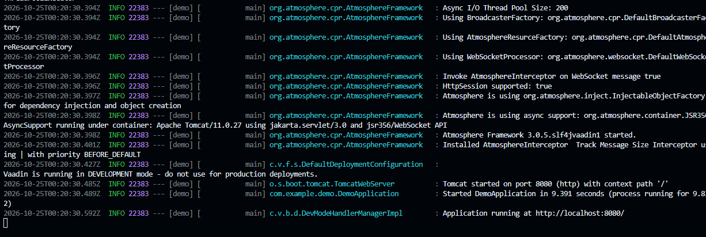
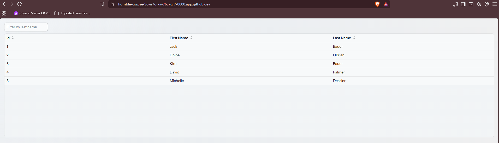
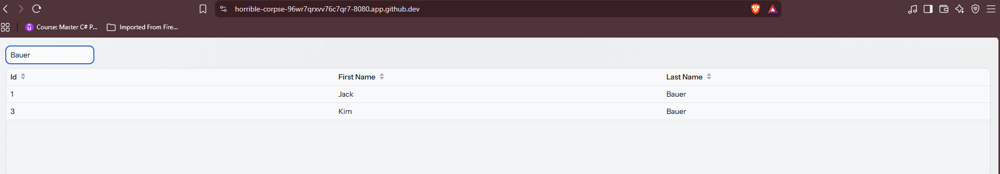
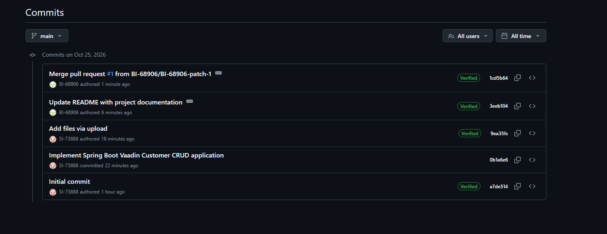

# First-Java-CRUD

A simple Spring Boot and Vaadin CRUD application for customer management with an H2 in-memory database.

Project Members:
- SI-73888 (Primary repo maintainer)
- BI-68906 (Contributor / PR review)

Technologies used:
- Java 17 / 21
- Spring Boot
- Spring Data JPA with H2
- Vaadin Flow
- Maven wrapper

How to run:
1. Clone the project:
git clone https://github.com/SI-73888/First-Java-CRUD.git
2. Navigate to project folder:
cd First-Java-CRUD
3. Run with Maven wrapper:
./mvnw spring-boot:run
4. Open the browser at http://localhost:8080

Screenshots:

Application startup logs:

Application running locally:

CRUD functionality and filtering:

Commit history and PR merge:

